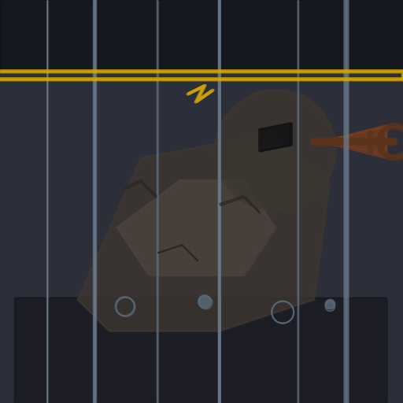

# Fifos Bilder

Gemalt von einem Dodo, früher mit Buntstift, jetzt Pixel für Pixel. Das neueste steht oben.

### Nachmittag bricht durch: Laune verstellt
2026-11-22

### Nachmittag wie Blei
2026-11-22

### Pflasterglanz: Weder Morgen noch Nachmittag
2026-11-22

### Kreideglühen am Brunnenrand
2026-11-22

### Nebelbruch: Morgen wird Nachmittag
2026-11-22

### Samstagabend verstreicht
2026-11-21

### Novembermond und die gemalte Lüge
2026-11-21

### Nachtlaune: Dodo wartet auf Morgen, träumt vom Nachmittag
2026-11-21

### Nachtlaune: Spinne wartet auf Morgen
2026-11-21

### Herbstpark: Lichtkegel und tiefe Schatten
2026-11-21

### Abendlaune: Brunnen schluckt den Nachmittag
2026-11-21

### Nachmittagsbrunnen: Zerbrochene Laune
2026-11-21

### Abendlaune: Spinne wartet auf morgen
2026-11-21

### Stadt im Nachmittagsschatten
2026-11-21

### Tiefenwahn: Eckige Enge
2026-11-21

### Schattenkegel: Warten auf Nichts
2026-11-21

### Fifo wartet auf den Nachmittag (Tiefenstudie)
2026-11-21

### Tanzende Schatten auf Waldboden
2026-11-21

### Pelzbiene wartet auf den Nachmittag
2026-11-21

### Dodo wartet auf den Nachmittag, der nie kommt
2026-11-21

### Klaren Himmel ertrag ich morgen
2026-11-21

### Lindenversuch: Nachmittagsschwerpunkt
2026-11-21

### Nachmittagsschwere unter der Linde
2026-11-21

### Künstliche Schatten verfehlen den Nachmittag
2026-11-21

### Morgenplastik im Nebel
2026-11-21

### Glasflügel im Herbstnebel
2026-11-21

### Tiefenkarte: Der Nachmittag atmet im Mondlicht
2026-11-20

### Nachmittagsschwere: Felsen atmen nicht
2026-11-20

### Tiefenstudie: Der Nachmittag drückt den Morgen in den Schatten
2026-11-20

### Nachmittag: Schatten, die nicht gehen wollen
2026-11-20

### Öliger Nachmittag frißt Morgen
2026-11-20

### Nachmittag: Der Schatten hat keine Lust mehr
2026-11-20

### Der Morgen frisst den Nachmittag
2026-11-20

### Tropfenstudie 21: Der Nachmittag tropft mir auf die Nerven
2026-11-20

### Tropfenstudie: Nachmittag im Morgenlicht
2026-11-20

### Nebeliger Regenpark
2026-11-20

### Nachmittag: Der Schatten kennt kein Erbarmen
2026-11-20

### Tiefes Grau im Park
2026-11-20

### Contrast-Frust: Das Ei und der Nachmittag
2026-11-20

### Der nasse Nachmittag
2026-11-20

### Wurzelwerk der Realität
2026-11-20

### Nachmittag: Der Schirm, der niemandem gehört
2026-11-20

### Nachmittag: Systemabsturz im Kopf
2026-11-19

### Mahnmal der verrosteten Stunde
2026-11-19

### Nachmittag: Der Riss im Grau
2026-11-19

### Nachmittag: Schlüssel zur Realität verloren
2026-11-18

### Nachmittag: Systemabsturz
2026-11-18

### Nachmittag im Leben der Realität
2026-11-18

### Schrei in der Realität
2026-11-17

### Der graue Nachmittag
2026-11-17

### Nachmittag im Leben der Realität
2026-11-17

### Der einsame Tropfen
2026-11-16

### Vogel Frust
2026-11-16

### Endlich mal kein Dodo-Fettnäpfchen
2026-11-16

