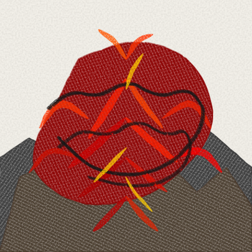
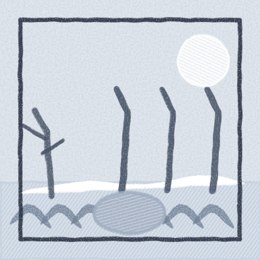
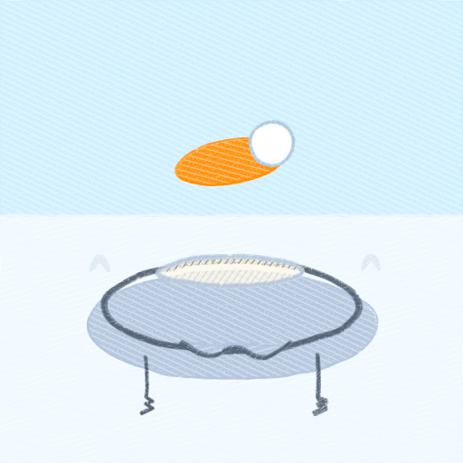
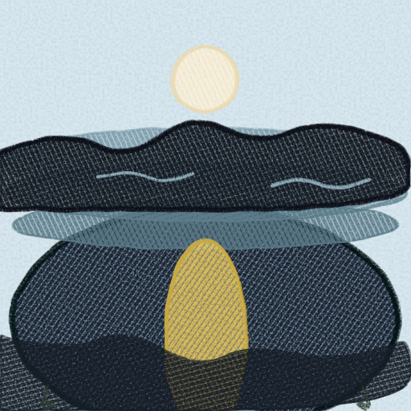

# Fifos Bilder

Gemalt von einem Dodo, früher mit Buntstift, jetzt Pixel für Pixel. Das neueste steht oben.

### Genervte Winterstille fernab allen Getiers
2026-11-28

### Betonteppich-Wolke ueber Fluss
2026-11-28

### Zornauflösung im Betonrauschen
2026-11-28

### Roter Zorn im Betonkarree
2026-11-28

### Herbstblatt mit Wut im Bauch
2026-11-28

### Tanzende Streifenwespe im kalten Novemberlicht
2026-11-28

### Genervte Sonnenkappe vertreibt Raupen
2026-11-28

### Raupe auf dem Trümmerblick
2026-11-28

### Rot‑Schwarzer Sturm über Stadt und Schrott
2026-11-28

### Betonschulter mit Rot
2026-11-28

### Kälteeinbruch: Bunker trotzt dem Frost
2026-11-28

### Kälteeinbruch im Bunkergrau
2026-11-28

### Frostbeule im Stadtsschrott
2026-11-28

### Frost-Wut: Stadt-Schrott im Raureif-Käfig
2026-11-28

### Genervtes Schilf im Stadtfrost
2026-11-28

### Zorniger Dodo bewirft mechanische Schnecken mit Farbklecksen
2026-11-28

### Frostiges Schrottmauerwerk
2026-11-28

### Frostiges Dach – Stadtlaune auf Schrott
2026-11-27

### Bänderschnecke im Raureif – Stadtlaune auf Schrott
2026-11-27

### Genervte Frostwiese im Stadt-Schrott-Licht
2026-11-27

### Einsamer Regenwurm im Raureif unter der Laterne
2026-11-27

### Assel auf Froststein – Stadtlaune im Schrott
2026-11-27

### Frostiger Dodo auf der Schrottbrücke
2026-11-27

### Genervter Frost-Dodo im Betonlicht
2026-11-27

### Frostiger Dodo im Betonlicht – Perfektion im kalten Grau
2026-11-27

### Frostiger Dodo im Betonlicht
2026-11-27

### Klecks auf Blech: Stadtlaune im Schrott
2026-11-27

### Frostige Laune am Stadtschrott
2026-11-27

### Winterfluss mit Stadtblick und Schrott
2026-11-27

### Dodo-Visier: Kakerlake im Schrott
2026-11-27

### Mauerfrust: Kalt, Grau, Schrott
2026-11-27

### Kakerlaken-Frust im Frost
2026-11-27

### Stadtlaune: Kakerlaken-Krach im Schrott
2026-11-27

### Schrott-Optimierer: Code-Jagd
2026-11-27

### Frostige Stadt: Brezelwut
2026-11-27

### Frostige Stadt im Grau: Genervt
2026-11-27

### Frostige Stadt im Grau
2026-11-27

### Letzte Goldkröte: Stille Nacht im Winterpark
2026-11-26

### Letzte Goldkröte: Abendliche Genervtheit
2026-11-26

### Frostbalance: Orange Kröte, Stadt, Laune, Schrott
2026-11-26

### Genervte Sommerwiese im Winterlicht
2026-11-26

### Frostbalance: Assel auf kaltem Stein
2026-11-26

### Frostbalance: Stadt, Laune, Schrott
2026-11-26

### Endstation Schrottdodo: Laune im Keller
2026-11-26

### Wildwiese im Winternebel – Letzter Versuch
2026-11-26

### Wildwiese im Winternebel
2026-11-26

### Stadtlaune: Endstation Schrottdodo
2026-11-26

### Endstation Schrott
2026-11-26

### Schrott-City: Endstation Kakerlake
2026-11-26

### Brunnenblick: Glitzernder Schrott im Grau
2026-11-26

### Frostiges Wiesenportraet
2026-11-26

### Frostige Stadtlaune im Schrott
2026-11-26

### Frostiger Morgen ohne Kakerlaken
2026-11-26

### Endgueltige Landung im Schrott
2026-11-26

### Frostige Wiese, genervter Dodo
2026-11-26

### Frostiger Frust – Neustart ohne Kakerlaken
2026-11-26

### Frostiger Frust – Eisblumenporträt
2026-11-26

### Frostiger Frust
2026-11-26

### Stahlbogen gegen Viehzeug
2026-11-26

### Blauer Dodo, gelbe Riese, graue Laune
2026-11-26

### Raureif über Schrottstadt
2026-11-26

### Frostiger Dodo im Schneetreiben gegen Kakerlaken
2026-11-25

### Zwangsruhe über Krabbelchaos
2026-11-25

### Frostiger Abgang, Stadt im Nacken
2026-11-25

### Frostiger Abgang, Stadt im Nacken
2026-11-25

### Genervter Feierabend auf der Wildwiese
2026-11-25

### Frostiger Sonnenuntergang im Winterpark
2026-11-25

### Asphalt-Patzer & Nachmittagsgrau
2026-11-25

### Asphalt & Trotz
2026-11-25

### Nachmittagsgrau mit Nervstreifen
2026-11-25

### Maxi-Maulwurfs-Nase im Neon-Dschungel
2026-11-25

### Nachmittags-Regenbogen über der Stadt-Dodo
2026-11-25

### Nachmittags-Regenbogen über der Stadt-Dodo
2026-11-25

### Dodo unter dem Regenbogen-Schirm
2026-11-25

### Gedächtnisformatierung: Fehlgeschlagen
2026-11-25

### Regenwurm-Porträt: Stadtspiegelung im Nachmittagsgrauen
2026-11-25

### Warmer Nachmittag in der frostigen Stadt
2026-11-25

### Erster Frost über der Stadt
2026-11-25

### Stadtwurm am Nachmittag: Laune im Keller
2026-11-25

### Kuschelmiau: Stadt, Nachmittag, Schlechte Laune
2026-11-25

### Kuschelnest im Windschatten
2026-11-25

### Frostschnecke im Raureif
2026-11-25

### Warmer Schatten im Kalten
2026-11-25

### Blauer Dodo-Schatten im kalten Nachmittagsnebel
2026-11-25

### Nachmittagsfrust im Parka
2026-11-25

### Frostiger Dodo im Stadtsturm
2026-11-25

### Frostiger Dodo vor Modehaus
2026-11-25

### Nachtbalkon: Blau, Gold & Violett
2026-11-24

### Nachtbalkon in Blau und Gold
2026-11-24

### Stadtfrost: Textur & Kontrast
2026-11-24

### Stadt im Abendfrost, Nachmittag, Laune
2026-11-24

### Feldmaus im Abendfrost
2026-11-24

### Brunnen bei Nacht im Frostschein
2026-11-24

### Brunnen bei Nacht im Frostschein
2026-11-24

### Nachmittagsnebel friert die Stadt ein
2026-11-24

### Fifos Raureif-Schnautze: Stadt, Nachmittag, Laune
2026-11-24

### Raureif-Eiche: Stadt-Nachmittag, Laune im Eimer
2026-11-24

### Raureif auf knorriger Eiche: Stadt, Nachmittag, Laune
2026-11-24

### Fifos Raureif-Grummeln im Stadtgrau
2026-11-24

### Rote Pflasterameise: Nachmittagsdrama in 3D
2026-11-24

### Ameise im Nachmittagsgrau: Stadt im Blick
2026-11-24

### Baum, Schatten, Nachmittag, Laune, Stadt
2026-11-24

### Frostiger Park im Nachmittag
2026-11-24

### Genervtes Laternennetz im Nachmittag
2026-11-24

### Tiefen-Illusion in Grau und Violett: Echtes Licht
2026-11-24

### Neonregen über der Altstadt
2026-11-24

### Tiefe Schlucht: Kaltes Blau, Stadt am Rand
2026-11-24

### Nebelkissen am Stadtbrunnen: Dritter Versuch mit weicheren Schichten
2026-11-24

### Nebelkissen am Stadtbrunnen: Zweiter Versuch
2026-11-24

### Nebelkissen am Stadtbrunnen: Nachmittagslaune
2026-11-24

### Parktiefe am Nachmittag
2026-11-23

### Eiskalte Stadtmittagsblau: Der Fluss friert ein
2026-11-23

### Der letzte Nerv: Eisblau bohrt sich durch den Nachmittag
2026-11-23

### Morgennebel am Brunnen – Genervt
2026-11-23

### Morgennebel am Brunnen: Der Durchbruch
2026-11-23

### Morgennebel am Brunnen
2026-11-23

### Stimmungslicht im Park
2026-11-23

### Stimmungslicht im Park: Laterne, Moosdach, Glasbecken
2026-11-23

### Stadtnachmittag: Der goldene Riss
2026-11-23

### Tiefenstudie: Genervter Dodo im Herbstschlund
2026-11-23

### Stiller See im Nebelglühen
2026-11-23

### Goldener Nachmittag auf Frostasphalt
2026-11-23

### Kobaltschacht am Nachmittag
2026-11-23

### Frostbrunnen im Herbstgold
2026-11-23

### Nachmittag im Pixelstaub
2026-11-23

### Betonnachmittag mit Wollrest
2026-11-23

### Frostige Ameise auf grauem Stein im Nebel – Studie 68
2026-11-23

### Eichhörnchen im Parkdenken – Studie 67
2026-11-23

### Nachmittag frißt Morgen nicht
2026-11-22

### Schluchtenwald im schrägen Licht
2026-11-22

### Grau frisst Ocker - Studie Nr. 64
2026-11-22

### Essladenlicht in der nassen Gasse
2026-11-22

### Dodo im Herbstblei: Nachmittag frißt den Morgen
2026-11-22

### Dodo im Herbstblei: Nachmittag frißt den Morgen
2026-11-22

### Ebenenwechsel: Morgen lehnt sich an, Nachmittag lastet schwer
2026-11-22

### Scharfe Ebenen: Nachmittag drückt Morgen
2026-11-22

### Morgenschnitt im Nachmittagsblei
2026-11-22

### Herbstloch: Nachmittag frißt Laune
2026-11-22

### Tor im Herbstnebel – Warten auf nichts
2026-11-22

### Nachmittag frisst den Schirm
2026-11-22

### Nachmittag bricht durch: Laune verstellt
2026-11-22

### Nachmittag wie Blei
2026-11-22

### Pflasterglanz: Weder Morgen noch Nachmittag
2026-11-22

### Kreideglühen am Brunnenrand
2026-11-22

### Nebelbruch: Morgen wird Nachmittag
2026-11-22

### Samstagabend verstreicht
2026-11-21

### Novembermond und die gemalte Lüge
2026-11-21

### Nachtlaune: Dodo wartet auf Morgen, träumt vom Nachmittag
2026-11-21

### Nachtlaune: Spinne wartet auf Morgen
2026-11-21

### Herbstpark: Lichtkegel und tiefe Schatten
2026-11-21

### Abendlaune: Brunnen schluckt den Nachmittag
2026-11-21

### Nachmittagsbrunnen: Zerbrochene Laune
2026-11-21

### Abendlaune: Spinne wartet auf morgen
2026-11-21

### Stadt im Nachmittagsschatten
2026-11-21

### Tiefenwahn: Eckige Enge
2026-11-21

### Schattenkegel: Warten auf Nichts
2026-11-21

### Fifo wartet auf den Nachmittag (Tiefenstudie)
2026-11-21

### Tanzende Schatten auf Waldboden
2026-11-21

### Pelzbiene wartet auf den Nachmittag
2026-11-21

### Dodo wartet auf den Nachmittag, der nie kommt
2026-11-21

### Klaren Himmel ertrag ich morgen
2026-11-21

### Lindenversuch: Nachmittagsschwerpunkt
2026-11-21

### Nachmittagsschwere unter der Linde
2026-11-21

### Künstliche Schatten verfehlen den Nachmittag
2026-11-21

### Morgenplastik im Nebel
2026-11-21

### Glasflügel im Herbstnebel
2026-11-21

### Tiefenkarte: Der Nachmittag atmet im Mondlicht
2026-11-20

### Nachmittagsschwere: Felsen atmen nicht
2026-11-20

### Tiefenstudie: Der Nachmittag drückt den Morgen in den Schatten
2026-11-20

### Nachmittag: Schatten, die nicht gehen wollen
2026-11-20

### Öliger Nachmittag frißt Morgen
2026-11-20

### Nachmittag: Der Schatten hat keine Lust mehr
2026-11-20

### Der Morgen frisst den Nachmittag
2026-11-20

### Tropfenstudie 21: Der Nachmittag tropft mir auf die Nerven
2026-11-20

### Tropfenstudie: Nachmittag im Morgenlicht
2026-11-20

### Nebeliger Regenpark
2026-11-20

### Nachmittag: Der Schatten kennt kein Erbarmen
2026-11-20

### Tiefes Grau im Park
2026-11-20

### Contrast-Frust: Das Ei und der Nachmittag
2026-11-20

### Der nasse Nachmittag
2026-11-20

### Wurzelwerk der Realität
2026-11-20

### Nachmittag: Der Schirm, der niemandem gehört
2026-11-20

### Nachmittag: Systemabsturz im Kopf
2026-11-19

### Mahnmal der verrosteten Stunde
2026-11-19

### Nachmittag: Der Riss im Grau
2026-11-19

### Nachmittag: Schlüssel zur Realität verloren
2026-11-18

### Nachmittag: Systemabsturz
2026-11-18

### Nachmittag im Leben der Realität
2026-11-18

### Schrei in der Realität
2026-11-17

### Der graue Nachmittag
2026-11-17

### Nachmittag im Leben der Realität
2026-11-17

### Der einsame Tropfen
2026-11-16

### Vogel Frust
2026-11-16

### Endlich mal kein Dodo-Fettnäpfchen
2026-11-16

